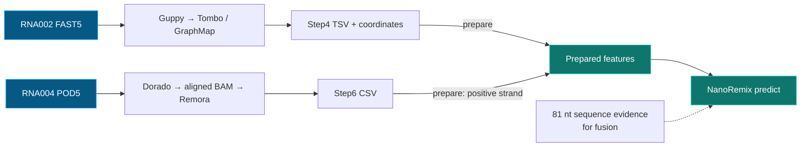

<h1 align="center">NanoRemix</h1>

<p align="center"><strong>Read-level RNA modification calling from Oxford Nanopore direct RNA sequencing</strong></p>

<div align="center">

**RNA002 & RNA004** · **Binary & Multi classification** · **Optional signal–sequence fusion**

[1. Coverage](#1-supported-modifications-and-commands) · [2. Evidence](#2-second-generation-and-third-generation-evidence) · [3. Strategies](#3-signal-strategies) · [4. Installation](#4-install-the-tool-and-select-weights) · [5. Input](#5-preprocess-reads-and-prepare-input)

**Applications** · [6. Run a prediction](#6-run-a-prediction) · [7. Binary classification](#7-binary-classification) · [8. Multi classification](#8-multi-classification) · [9. Sequence and fusion](#9-sequence-only-and-fused-predictions) · [10. Read results](#10-read-the-results)

**[User guide](USER_GUIDE.md)** · **[Full CLI reference](docs/OPTIONS.md)** · **[Pretrained weights](https://github.com/iris982022/nanoremix_tool_ENG/releases/tag/v0.3.0)**

</div>

NanoRemix scores each candidate position on each read. One CLI covers both ONT chemistries with matching pretrained weights. You can use Nanopore signal evidence on its own, add aligned sequence evidence, or start from compatible precomputed probabilities. Every run records the selected classes, evidence source and reasons for rejected candidates.

## 1. Supported modifications and commands

### 1.1 Modification coverage

**Binary** supports three dedicated comparisons for both chemistries: A vs m6A, C vs m5C and U vs pseudouridine (`pseudoU`). Request one or more pairs in the same run. Each candidate is evaluated in the family of its reference base.

**Multi** compares selected classes within each reference-base family. The signal models support the following modifications, plus the unmodified classes A, C, G and U.

| Reference base | RNA002 Multi · 14 modifications | RNA004 Multi · 12 modifications |
| :--- | :--- | :--- |
| A | m6A, m1A, Inosine, Am | m6A, m1A, Am |
| C | m5C, hm5C, ac4C, FormylC | m5C, hm5C, ac4C |
| G | m7G, o8G | o8G, Gm |
| U | pseudoU, m1psi, m5U, Um | pseudoU, m1psi, m5U, Um |

The shared **second-generation sequence model** covers 11 modifications: m6A, m1A, Inosine, Am, m5C, ac4C, m7G, Gm, pseudoU, m5U and Um, plus A/C/G/U. With default extended fusion, classes supported only by the selected signal model retain their signal evidence. [Class selection and fusion coverage](USER_GUIDE.md#model-coverage)

### 1.2 CLI commands

| What you want to do | Command | Required input and result |
| :--- | :--- | :--- |
| Find supported labels | `nanoremix catalog --chemistry RNA004` | Optional chemistry. Returns the Binary, Multi, and evidence-specific class lists. |
| Convert extracted signal features | `nanoremix prepare` | RNA002 Step4 TSV / extracted table, or RNA004 positive-strand Step6 table. Writes a prepared feature table. |
| Check model files and dependencies | `nanoremix doctor` | Model directory and requested route. Reports file, metadata, hash and dependency checks. |
| Test the input and run inference | `nanoremix validate` | The same input and model arguments as `predict`. Returns a validation summary. |
| Classify candidate modifications | `nanoremix predict` | Prepared features or compatible probabilities, plus any model assets required by the chosen route. Writes per-read calls, an audit table and a run manifest. |

## 2. Second-generation and third-generation evidence

RNA002 and RNA004 identify the ONT **sequencing chemistry**. In NanoRemix, second generation and third generation identify **which evidence the model uses**. Either chemistry can use the shared sequence model. An aligned reference sequence can supply its input without a separate Illumina experiment.

| Evidence | CLI selection | What to supply for each candidate |
| --- | --- | --- |
| Third generation (signal) | `--mode thirdgen` | Local Nanopore signal statistics and their short sequence context, plus the chemistry- and task-specific weights. Alternatively, supply compatible signal probabilities. |
| Second generation (sequence) | `--mode secondgen` | The reference center plus an oriented 81 nt sequence spanning it and the shared 25-checkpoint ensemble, or a complete 15-class sequence probability vector. |
| Signal and sequence together | `--data-type biological` | Both branches' inputs aligned to the same center and strand. Add `--also-thirdgen --also-secondgen` to save separate component predictions for the same candidates. |

Choose one route option per command. A biological sample can also be scored using signal alone with `--mode thirdgen`. Section 9 gives commands for sequence-only prediction and fusion.

## 3. Signal strategies

| Option | What the signal model does | Output |
| --- | --- | --- |
| `--strategy s1` | Evaluates shifted windows separately (five for RNA002, nine for RNA004) and combines their predictions. | One S1 result per candidate |
| `--strategy s2` (default) | Scores all signal positions jointly. Binary uses one joint classifier per modification. | One S2 result per candidate |
| `--strategy both` | Runs S1 and S2 on the same input. | Separate `s1/` and `s2/` result directories |

The released weights use **`--condition full`**. Each signal block contributes its mean, median, standard deviation and length. For Binary, an individual S1 classifier takes **20 features for RNA002 or 36 for RNA004**. S2 takes **52 or 100**, respectively, including the encoded flanking bases. The historical Binary weight path `strategy3/m_all_calibrated.pkl` corresponds to the public S2 option. Sequence-only predictions use the shared sequence ensemble and have no signal strategy. [Feature definitions and weight layout](docs/MODELS.md#binary-strategies-and-sf7)

<details>
<summary>View SF7 for m6A, m5C and pseudouridine</summary>


Panel A shows Zero-scenario research models. Panel B shows the released S2 weights in the Total scenario. RNA002 uses different test splits for S2 and the baselines. [Download SF7 (PDF)](https://github.com/iris982022/nanoremix_tool_ENG/raw/refs/heads/main/docs/figures/SF7.pdf) · [Panel B scores and sample counts](docs/figures/SF7B.tsv)

</details>

## 4. Install the tool and select weights

### 4.1 Install the CLI

Use Python 3.10 or 3.11 for the released weights. Run the remaining examples in the repository root with this environment active.

```bash
git clone https://github.com/iris982022/nanoremix_tool_ENG.git
cd nanoremix_tool_ENG
python -m venv .venv
source .venv/bin/activate
python -m pip install -e '.[models]' -c constraints-models.txt
nanoremix catalog --chemistry RNA004
```

### 4.2 Download the weights for your application

Section 6 runs on supplied probabilities. For sections 7 and 8, download the RNA004 Binary and Multi ZIPs. For section 9, also download SecondGen. The commands below prepare all three examples. To run only one, keep the corresponding package names in the loop.

```bash
for package in RNA004_Binary RNA004_Multi SecondGen; do
  asset="NanoRemix_v0.3.0_models_${package}_20261104.zip"
  curl -fL "https://github.com/iris982022/nanoremix_tool_ENG/releases/download/v0.3.0/$asset" -o "$asset" || break
  unzip -n "$asset" || break
done
```

Extracting the ZIPs creates `models/` and its shared `SHA256.json`. For RNA002, select `RNA002_Binary` or `RNA002_Multi` and set `--chemistry RNA002` in the prediction command.

| Model | Included files |
| :--- | :--- |
| RNA002 Binary / Multi | 18 / 6 `.pkl` files, respectively. Multi includes its strategy manifests. |
| RNA004 Binary / Multi | 30 / 10 `.pkl` files, respectively. Multi includes its strategy manifests. |
| Shared SecondGen | 25 `.pt` checkpoints and the network definition, shared by RNA002 and RNA004. |

[Download the five model ZIPs and SHA256 list](https://github.com/iris982022/nanoremix_tool_ENG/releases/tag/v0.3.0) · [Model layout and dependencies](docs/MODELS.md)

## 5. Preprocess reads and prepare input

### 5.1 From raw reads to extracted features



- **RNA002** — Basecall with Guppy using `--fast5_out`, split to single-read FAST5, resquiggle with Tombo/GraphMap, and retain the Step4 features and coordinate sidecar. Run `nanoremix prepare --input step4.tsv --chemistry RNA002 --format step4 --output prepared002.csv`.
- **RNA004** — Basecall with Dorado using `--emit-moves`, align and sort the BAM, then use Remora to extract features and merge them into Step6. Run `nanoremix prepare --input step6_positive.csv --chemistry RNA004 --format step6 --output prepared004.csv` for explicit positive-strand input. For negative-strand candidates, supply a correctly oriented prepared table from a validated adapter.

If you already have a prepared table, start with `predict`. For sequence-based fusion, use the same candidate center and reference orientation. Use transcript or verified splice-aware coordinates when the 81 nt window crosses a junction. [Full preprocessing commands](docs/guide_20261104/PREPROCESSING.md)

### 5.2 Prediction input formats

The prediction input is a UTF-8 CSV or TSV with a header. Gzip is supported. Each row is one read–candidate observation.

- **Third-generation feature input** uses `9mer_final` with 9 nt for RNA002 or 17 nt for RNA004. It has four groups of signal columns (`mean_output1…K`, `median_output1…K`, `std_output1…K` and `length_output1…K`), with K=5 for RNA002 and K=9 for RNA004.
- **Precomputed third-generation probabilities** use `--input-kind probabilities` and include a reference center. Binary requires a column such as `s2_prob_m6A` for each requested pair and strategy. Multi requires the full native probability axis for each strategy (18 classes for RNA002 and 16 for RNA004).
- **Second-generation evidence** uses a same-center, same-direction 81 nt sequence and the shared sequence model, or a complete 15-class probability vector per candidate. A separate probability table joins by an explicit key such as `record_key`. [Input columns and examples](docs/INPUTS.md)

## 6. Run a prediction

`nanoremix predict` is the classification command for **both** tasks. Choose the chemistry, task, target modifications and evidence route. Use a new output directory for each run. The following first run classifies two artificial A-centered candidates from probabilities already in the repository.

```bash
nanoremix predict --input examples/minimal_binary_probabilities.csv \
  --chemistry RNA004 --task binary --mods m6A \
  --input-kind probabilities --mode thirdgen --strategy s2 \
  --output results/quickstart
cat results/quickstart/thirdgen/s2/predictions.tsv
```

The two input `s2_prob_m6A` values are 0.90 and 0.20. The corresponding `predicted_label` values are `m6A` and `A`. For your own reads, start from a prepared table (section 5) and use the Binary or Multi feature-based command below. To check an input before saving results, run `nanoremix validate` with the same model and input arguments and omit `--output`.

## 7. Binary classification

**Is this A-centered observation A or m6A?** Select `--task binary --mods m6A` and the Binary ZIP matching the chemistry. The example checks the released RNA004 model and scores bundled artificial signal features.

```bash
nanoremix doctor --chemistry RNA004 --task binary --mods m6A --strategy s2 \
  --data-type synthetic --model-root models --model-checksums models/SHA256.json --strict

nanoremix predict --input docs/guide_20261104/examples/RNA004_prepared_with81.csv \
  --chemistry RNA004 --task binary --mods m6A \
  --mode thirdgen --strategy s2 --condition full \
  --model-root models --model-checksums models/SHA256.json --trust-model-files \
  --output results/rna004_binary
```

For your own sample, replace `--input` with `prepared004.csv`. The signal-only command uses the local context and signal columns. In `doctor`, `--data-type synthetic` restricts the preflight to signal-model assets. To run all three dedicated pairs, use `--mods m6A,m5C,pseudoU`. Each reference center selects its matching pair. Read `predicted_label`, `status` and the corresponding probability (such as `prob_m6A`) in `results/rna004_binary/thirdgen/s2/predictions.tsv`.

## 8. Multi classification

**At an A-centered candidate, which of A, m6A and m1A best fits the evidence?** Select `--task multi`, the RNA004 Multi ZIP and the exact label set with `--targets`. The input feature schema is the same as for Binary.

```bash
nanoremix predict --input docs/guide_20261104/examples/RNA004_prepared_with81.csv \
  --chemistry RNA004 --task multi --targets A,m6A,m1A \
  --mode thirdgen --strategy s2 --condition full \
  --model-root models --model-checksums models/SHA256.json --trust-model-files \
  --output results/rna004_multi
```

Open `results/rna004_multi/thirdgen/s2/predictions.tsv`. For eligible A-centered rows, compare `prob_A`, `prob_m6A` and `prob_m1A` alongside the winning label. Scores are conditional on the selected classes within the reference-base family. To screen across families, **replace** `--targets A,m6A,m1A` with `--mods all` or a list such as `--mods m6A,m1A,m5C,pseudoU`. The latter adds the corresponding unmodified controls.

## 9. Sequence-only and fused predictions

Both examples use the bundled `sequence81` column. For your own candidates, supply an 81 nt sequence in RNA orientation with the target at nucleotide 41, or join a complete table of precomputed sequence probabilities. [Sequence input and join keys](docs/INPUTS.md)

### 9.1 Run the second-generation sequence model

Install the sequence dependencies and extract the shared SecondGen ZIP from section 4.2.

```bash
python -m pip install -e '.[models,second]' -c constraints-models.txt
nanoremix predict --input docs/guide_20261104/examples/RNA004_prepared_with81.csv \
  --chemistry RNA004 --task multi --targets A,m6A,m1A \
  --mode secondgen --sequence-column sequence81 \
  --model-root models --model-checksums models/SHA256.json --trust-model-files \
  --output results/rna004_sequence
```

Read `results/rna004_sequence/secondgen/none/predictions.tsv`. The `none` directory denotes a sequence-only result.

### 9.2 Fuse third-generation signal and second-generation sequence

Use the RNA004 Multi and shared SecondGen ZIPs with the environment from section 9.1. This example saves the fused result and both components so you can compare calls for the same candidate.

```bash
nanoremix predict --input docs/guide_20261104/examples/RNA004_prepared_with81.csv \
  --chemistry RNA004 --task multi --mods m6A,m1A,m5C,pseudoU --strategy s2 \
  --data-type biological --sequence-column sequence81 --also-thirdgen --also-secondgen \
  --model-root models --model-checksums models/SHA256.json --trust-model-files \
  --output results/rna004_fusion
```

The primary calls are in `results/rna004_fusion/fused/s2/predictions.tsv`. The `evidence_source` field records which evidence contributed. The component tables are under `thirdgen/s2/` and `secondgen/none/` within the same run directory.

## 10. Read the results

| File | What to check |
| --- | --- |
| `predictions.tsv` | One row per reported read–candidate observation. Read `predicted_label` together with `status` and the class probabilities. In the Binary example, `status=ok` and `predicted_label=m6A` indicate an accepted m6A call. |
| `selection_audit.tsv` | Includes rejected and out-of-scope candidates, with their status. Use this table when checking which observations entered an analysis. |
| `run_manifest.json` | Records run settings and hashes at the output root. |

Use `--min-confidence` to set a minimum winning conditional probability and `--output-filter modified` to report only accepted modification calls. For site-level comparisons, aggregate read-level calls using the procedure in the user guide. [Output interpretation](USER_GUIDE.md#interpret-the-output) · [Every CLI option and default](docs/OPTIONS.md)
