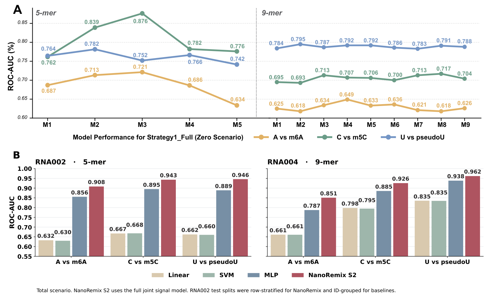
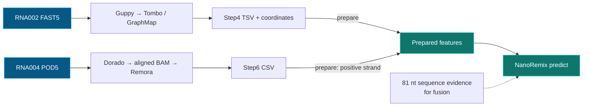

<h1 align="center">NanoRemix</h1>

<p align="center"><strong>Read-level RNA modification calling from Oxford Nanopore direct RNA sequencing</strong></p>

<div align="center">

**RNA002 & RNA004** · **Binary & Multi classification** · **Optional signal–sequence fusion**

[Supported modifications](#1-supported-modifications) · [Commands and inputs](#2-commands-and-inputs) · [Key parameters](#3-key-parameters) · [Preprocessing](#4-recommended-preprocessing) · [Run detection](#5-detect-modifications-with-pretrained-models)

**[User guide](USER_GUIDE.md)** · **[Full CLI reference](docs/OPTIONS.md)** · **[Pretrained weights](https://github.com/iris982022/nanoremix_tool_ENG/releases/tag/v0.3.0)**

</div>

NanoRemix scores each candidate position on each read. One CLI covers both ONT chemistries with matching pretrained weights. You can use Nanopore signal evidence on its own, add aligned sequence evidence, or start from compatible precomputed probabilities. Every run records the selected classes, evidence source and reasons for rejected candidates.

## 1. Supported modifications

**Binary** supports three dedicated comparisons for both chemistries: A vs m6A, C vs m5C and U vs pseudouridine (`pseudoU`). Request one or more pairs in the same run. Each candidate is evaluated in the family of its reference base.

**Multi** compares selected classes within each reference-base family. The signal models support the following modifications, plus the unmodified classes A, C, G and U.

| Reference base | RNA002 Multi · 14 modifications | RNA004 Multi · 12 modifications |
| :--- | :--- | :--- |
| A | m6A, m1A, Inosine, Am | m6A, m1A, Am |
| C | m5C, hm5C, ac4C, FormylC | m5C, hm5C, ac4C |
| G | m7G, o8G | o8G, Gm |
| U | pseudoU, m1psi, m5U, Um | pseudoU, m1psi, m5U, Um |

The shared **second-generation sequence model** covers 11 modifications: m6A, m1A, Inosine, Am, m5C, ac4C, m7G, Gm, pseudoU, m5U and Um, plus A/C/G/U. With default extended fusion, classes supported only by the selected signal model retain their signal evidence. [Class selection and fusion coverage](USER_GUIDE.md#model-coverage)

## 2. Commands and inputs

| What you want to do | Command | Required input and result |
| :--- | :--- | :--- |
| Find supported labels | `nanoremix catalog --chemistry RNA004` | Optional chemistry. Returns the Binary, Multi, and evidence-specific class lists. |
| Convert extracted signal features | `nanoremix prepare` | RNA002 Step4 TSV / extracted table, or RNA004 positive-strand Step6 table. Writes a prepared feature table. |
| Check model files and dependencies | `nanoremix doctor` | Model directory and requested route. Reports file, metadata, hash and dependency checks. |
| Test the input and run inference | `nanoremix validate` | The same input and model arguments as `predict`. Returns a validation summary. |
| Classify candidate modifications | `nanoremix predict` | Prepared features or compatible probabilities, plus any model assets required by the chosen route. Writes per-read calls, an audit table and a run manifest. |

The prediction input is a UTF-8 CSV or TSV with a header. Gzip is supported. Each row is one read–candidate observation.

- **Third-generation feature input** uses `9mer_final` with 9 nt for RNA002 or 17 nt for RNA004. It has four groups of signal columns (`mean_output1…K`, `median_output1…K`, `std_output1…K` and `length_output1…K`), with K=5 for RNA002 and K=9 for RNA004.
- **Precomputed third-generation probabilities** use `--input-kind probabilities` and include a reference center. Binary requires a column such as `s2_prob_m6A` for each requested pair and strategy. Multi requires the full native probability axis for each strategy (18 classes for RNA002 and 16 for RNA004).
- **Second-generation evidence** uses a same-center, same-direction 81 nt sequence and the shared sequence model, or a complete 15-class probability vector per candidate. A separate probability table joins by an explicit key such as `record_key`. [Input columns and examples](docs/INPUTS.md)

## 3. Key parameters

| Parameter | How to choose |
| :--- | :--- |
| `--chemistry RNA002` or `RNA004` | Match the ONT kit and model ZIP to the sample. |
| `--task binary` or `multi` | Use `binary` for dedicated modified/unmodified pairs, or `multi` for several competing classes in a reference-base family. |
| `--mods m6A,m5C` or `all` | Select target modifications. NanoRemix adds matching unmodified controls by default. With Multi, use `--targets A,m6A,m1A` to specify the exact class set. |
| `--strategy s1`, `s2` or `both` | S1 combines position-specific signal models. S2 uses joint, multi-position signal models and is the default. `both` saves separate S1 and S2 results. |
| `--condition full` | Use the released signal weights. Each signal block supplies the mean, median, standard deviation and signal length. |
| `--mode thirdgen` | Use Nanopore signal features or compatible precomputed signal probabilities. |
| `--mode secondgen` | Use the sequence branch alone. Provide candidate reference-base identity plus sequences or complete second-generation probabilities. |
| `--data-type biological` | Fuse signal and sequence evidence. Add `--also-thirdgen --also-secondgen` to save the component outputs as well. Choose either `--data-type` or `--mode`. |
| `--sequence-column sequence81` | Identify the 81 nt sequence column. For a separate precomputed second-generation table, use `--second-probabilities second.tsv --join-on record_key`. |
| `--min-confidence` and `--output-filter` | Set the minimum winning conditional probability and choose `all`, `retained` or `modified`. The audit table covers every input candidate. |

“Second generation” and “third generation” refer to NanoRemix model branches. The additional sequence evidence can come from the same candidate's reference context, so fusion needs no separate Illumina data. [All options and defaults](docs/OPTIONS.md)

**Which Binary strategy should I run?** Choose `--strategy s1` to combine predictions from the shifted windows. Choose `--strategy s2` to score all windows together with one classifier per modification. This is the model stored under `strategy3/m_all_calibrated.pkl` in the release ZIPs. It uses 52 encoded features for RNA002 and 100 for RNA004. [Feature breakdown and SF7 benchmark](docs/MODELS.md#binary-strategies-and-sf7)

<details>
<summary>View SF7 for m6A, m5C and pseudouridine</summary>



Panel A shows Zero-scenario research models. Panel B shows the released S2 weights in the Total scenario. RNA002 uses different test splits for S2 and the baselines. [Download SF7 (PDF)](https://github.com/iris982022/nanoremix_tool_ENG/raw/refs/heads/main/docs/figures/SF7.pdf) · [Panel B scores and sample counts](docs/figures/SF7B.tsv)

</details>

## 4. Recommended preprocessing



- **RNA002** — Basecall with Guppy using `--fast5_out`, split to single-read FAST5, resquiggle with Tombo/GraphMap, and retain the Step4 features and coordinate sidecar. Run `nanoremix prepare --input step4.tsv --chemistry RNA002 --format step4 --output prepared002.csv`.
- **RNA004** — Basecall with Dorado using `--emit-moves`, align and sort the BAM, then use Remora to extract features and merge them into Step6. Run `nanoremix prepare --input step6_positive.csv --chemistry RNA004 --format step6 --output prepared004.csv` for explicit positive-strand input. For negative-strand candidates, supply a correctly oriented prepared table from a validated adapter.

If you already have a prepared table, start with `predict`. For sequence-based fusion, use the same candidate center and reference orientation. Use transcript or verified splice-aware coordinates when the 81 nt window crosses a junction. [Full preprocessing commands](docs/guide_20261104/PREPROCESSING.md)

## 5. Detect modifications with pretrained models

### Install and download

Use Python 3.10 or 3.11. The example below downloads the RNA004 Binary ZIP and runs the released m6A classifier on bundled artificial features. Run the commands in a fresh directory.

```bash
git clone https://github.com/iris982022/nanoremix_tool_ENG.git
cd nanoremix_tool_ENG
python -m venv .venv
source .venv/bin/activate
python -m pip install -e '.[models]' -c constraints-models.txt

asset=NanoRemix_v0.3.0_models_RNA004_Binary_20261104.zip
curl -fL "https://github.com/iris982022/nanoremix_tool_ENG/releases/download/v0.3.0/$asset" -o "$asset"
unzip "$asset"
```

The Release contains the following verified model packages. Extract the ZIPs you need in the repository root to populate `models/`.

| Model | Included files |
| :--- | :--- |
| RNA002 Binary / Multi | 18 / 6 `.pkl` files, respectively. Multi includes its strategy manifests. |
| RNA004 Binary / Multi | 30 / 10 `.pkl` files, respectively. Multi includes its strategy manifests. |
| Shared SecondGen | 25 `.pt` checkpoints and the network definition, shared by RNA002 and RNA004. |

[Download the five model ZIPs and SHA256 list](https://github.com/iris982022/nanoremix_tool_ENG/releases/tag/v0.3.0) · [Model layout and dependencies](docs/MODELS.md)

### Run an m6A call

```bash
nanoremix doctor --chemistry RNA004 --task binary --mods m6A --strategy s2 \
  --data-type synthetic --model-root models --model-checksums models/SHA256.json --strict

nanoremix predict \
  --input docs/guide_20261104/examples/RNA004_prepared_with81.csv \
  --chemistry RNA004 --task binary --mods m6A \
  --mode thirdgen --strategy s2 \
  --model-root models --model-checksums models/SHA256.json --trust-model-files \
  --output results/rna004_m6a
```

For your own data, change `--input` to `prepared004.csv` and use a new output directory. In `doctor`, `--data-type synthetic` scopes the preflight to signal-model assets. The prediction uses `--mode thirdgen` and can score prepared biological data.

### Run Multi or add sequence evidence

For RNA004 Multi, extract the **RNA004 Multi** ZIP and select `--task multi --mods all`, or specify a subset such as `--mods m6A,m1A,m5C,pseudoU`. For sequence-based fusion, also extract **SecondGen**, install the sequence dependencies, and supply an aligned `sequence81` column.

```bash
python -m pip install -e '.[models,second]' -c constraints-models.txt

nanoremix predict --input prepared004_with81.csv --output results/rna004_fusion \
  --chemistry RNA004 --task multi --mods m6A,m1A,m5C,pseudoU --strategy s2 \
  --data-type biological --sequence-column sequence81 \
  --also-thirdgen --also-secondgen \
  --model-root models --model-checksums models/SHA256.json --trust-model-files
```

### Read the calls

For the m6A example, open `results/rna004_m6a/thirdgen/s2/predictions.tsv`. Read `predicted_label` and `prob_m6A` together with `status`. A row with `status=ok` and `predicted_label=m6A` is an accepted read-level m6A call. Add `--output-filter modified` to save only accepted modified calls. `selection_audit.tsv` in the same directory includes rejected and out-of-scope candidates. `run_manifest.json` in the output root records the run settings and hashes. Fusion results appear under `fused/s2/` and include `evidence_source`. [Interpretation and site-level aggregation](USER_GUIDE.md#interpret-the-output)

<details>
<summary>Check the CLI without downloading models</summary>

After cloning and activating the environment, run:

```bash
python -m pip install -e .
nanoremix predict --input examples/minimal_binary_probabilities.csv \
  --chemistry RNA004 --task binary --mods m6A --input-kind probabilities \
  --mode thirdgen --strategy s2 --output results/quickstart
```

The two artificial rows return `m6A` and `A`.

</details>
