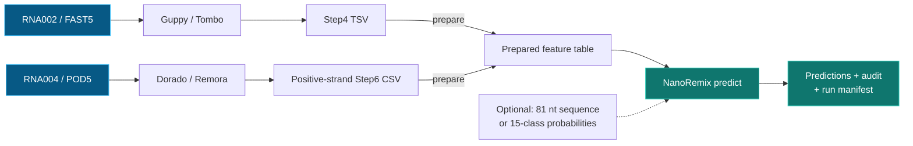

<h1 align="center">NanoRemix</h1>

<p align="center"><strong>RNA modification prediction from Oxford Nanopore direct RNA sequencing</strong></p>

<div align="center">

**RNA002 and RNA004** · **Targeted Binary and family-aware Multi** · **Optional sequence–signal fusion**

Source **v0.3.1** · Pretrained models **v0.3.0** · Recommended **Python 3.10 / 3.11**

[Model coverage](#1-model-coverage) · [Workflow](#2-from-reads-to-results) · [Quick start](#3-quick-start) · [Run a pretrained model](#4-run-a-pretrained-model)

**[User guide](USER_GUIDE.md)** · **[CLI reference](docs/OPTIONS.md)** · **[Pretrained models](https://github.com/iris982022/nanoremix_tool_ENG/releases/tag/v0.3.0)**

</div>

---

### What NanoRemix offers

| Capability | What it gives you |
| --- | --- |
| **One CLI across two chemistries** | Use the same commands with chemistry-specific RNA002 and RNA004 models. Choose a dedicated modified/unmodified pair or compare selected labels within the reference-base family. |
| **Signal and sequence, with a choice of evidence** | Run the Nanopore signal branch alone, or combine it with an aligned 81 nt sequence model. Supply compatible precomputed probabilities to bypass model inference for either branch. |
| **Auditable decisions for every candidate** | Inspect labels, conditional probabilities, evidence sources and rejection reasons. Each run records the input checksum, parameters, selected labels and hashes of loaded model files. |
| **Pretrained, route-specific downloads** | Download the weight ZIP for your chemistry and task. Add the shared sequence model only when you need to compute sequence probabilities. |

## 1. Model coverage

| Nanopore chemistry | Binary targets | Multi coverage | Required signal-model input per candidate |
| --- | --- | --- | --- |
| **RNA002** | m6A, m5C, pseudouridine (`pseudoU`) | 14 modifications + A/C/G/U | 9 nt context + 20 signal descriptors |
| **RNA004** | m6A, m5C, pseudouridine (`pseudoU`) | 12 modifications + A/C/G/U | 17 nt context + 36 signal descriptors |

Binary compares each target with its unmodified counterpart. Multi compares selected classes within each reference-base family. Choose S1 or S2, or save both strategies separately. Extended fusion preserves third-generation-only classes and records their evidence source. [Exact supported labels and evidence coverage](USER_GUIDE.md#model-coverage)

## 2. From reads to results



For RNA002, preserve basecalled FAST5 with Guppy `--fast5_out` and keep the Step4 coordinate sidecar. For RNA004, preserve the move table with Dorado `--emit-moves` before extracting signal features. Start at `predict` if you already have a compatible prepared feature or probability table. [Preprocessing steps and input contracts](USER_GUIDE.md#preprocess-raw-reads)

> [!IMPORTANT]
> The legacy RNA004 Step6 converter accepts explicit positive-strand input. Negative-strand candidates can be scored from a correctly oriented prepared table. The guide describes the required context, coordinate and signal-slot checks. [RNA004 conversion limits](USER_GUIDE.md#rna004-pod5-to-step6)

## 3. Quick start

Get the source and create an environment with Python 3.10 or 3.11. This two-row example uses artificial probabilities and requires no model downloads.

```bash
git clone https://github.com/iris982022/nanoremix_tool_ENG.git
cd nanoremix_tool_ENG
python -m venv .venv
source .venv/bin/activate
python -m pip install -e .

nanoremix predict \
  --input examples/minimal_binary_probabilities.csv \
  --chemistry RNA004 --task binary --mods m6A \
  --input-kind probabilities --mode thirdgen \
  --output results/quickstart
```

Open `results/quickstart/thirdgen/s2/predictions.tsv` to see `m6A` and `A`. Use a new output directory for each run.

## 4. Run a pretrained model

Download the RNA004 Binary ZIP and extract it at the repository root to create `models/`. The command below uses the released model on bundled example features. For your own data, replace `--input` with a prepared feature table in the same format. [Download RNA004 Binary weights](https://github.com/iris982022/nanoremix_tool_ENG/releases/download/v0.3.0/NanoRemix_v0.3.0_models_RNA004_Binary_20261104.zip)

```bash
python -m pip install -e '.[models]' -c constraints-models.txt

nanoremix predict \
  --input docs/guide_20261104/examples/RNA004_prepared_with81.csv \
  --chemistry RNA004 --task binary --mods m6A \
  --mode thirdgen --strategy s2 \
  --model-root models --model-checksums models/SHA256.json --trust-model-files \
  --output results/rna004_m6a
```

| To choose | Use |
| --- | --- |
| Chemistry, task and target | `--chemistry RNA002` or `RNA004`, `--task binary` or `multi`, and `--mods` with a list or `all` |
| Evidence and strategy | `--mode thirdgen` for signal-only inference, or `--data-type biological` for fusion. `--strategy s2` is the default, and `both` writes separate S1 and S2 outputs. |
| Fusion source | `--sequence-column sequence81` for an 81 nt sequence column, or `--second-probabilities second.tsv --join-on record_key` for a separate probability table |
| Saved predictions | `--output-filter retained` for accepted calls, or `modified` for accepted modified calls. The audit file includes all candidates. |

[All four workflows](USER_GUIDE.md#run-predictions) · [Output interpretation](USER_GUIDE.md#interpret-the-output) · [All options and defaults](docs/OPTIONS.md) · [License status](LICENSE)
